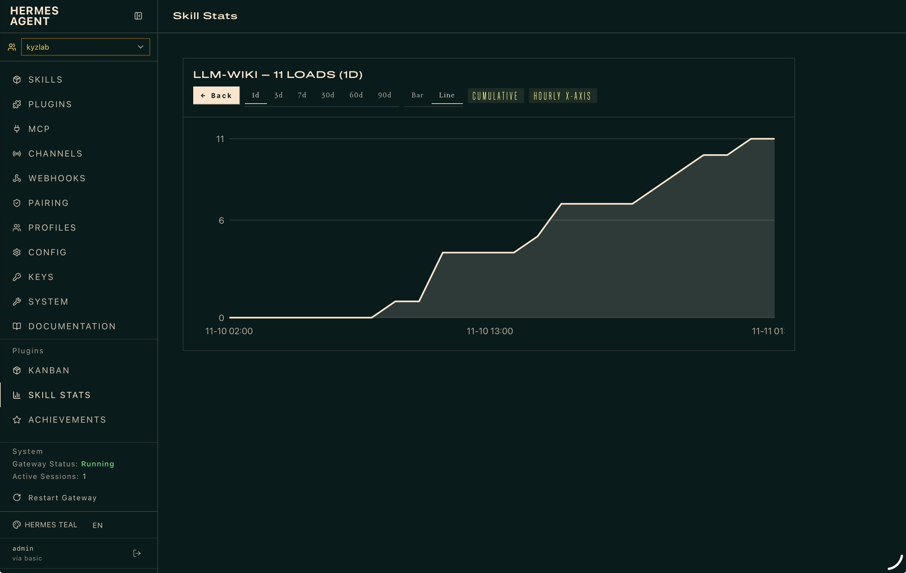
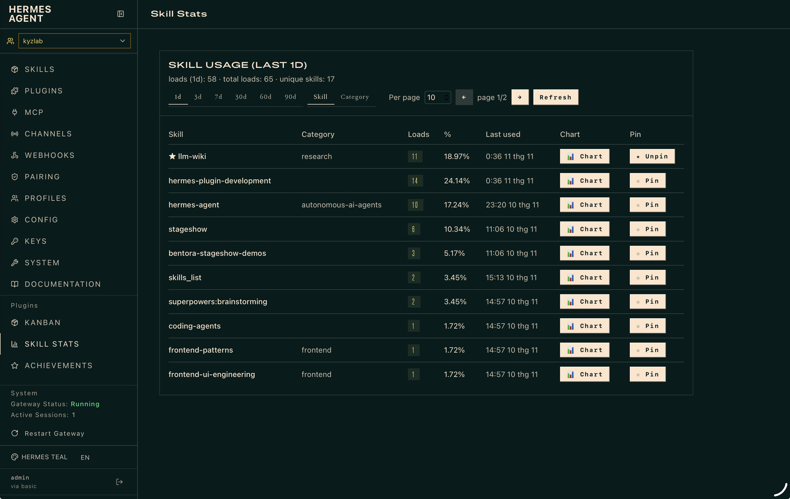

<p align="center">
  
</p>

# Skill Stats for Hermes Agent

Skill Stats counts every skill load in Hermes Agent and turns the counts into period-scoped statistics you can read from four places: the chat session, the TUI, the terminal, and the web Dashboard.

One rule drives everything: the plugin counts a skill every time Hermes loads it, records when it happened, and reports the numbers with period filters, paging, and grouping. No configuration is required after installation.

## Install

**Install straight from GitHub:**

```bash
hermes plugins install https://github.com/minhng92/skill-stats
hermes plugins enable skill-stats
hermes plugins doctor skill-stats
```

That is the whole install:

- The plugin places its own TUI widget into `$HERMES_HOME/tui-widgets/` at startup.
- The commands deliver the full feature set without extra steps.

**Alternative: manual copy**

If you have the folder locally (a clone or a download), copy it into the profile's plugins directory instead:

```bash
mkdir -p "$HERMES_HOME/plugins"
cp -r skill-stats "$HERMES_HOME/plugins/"
# or, so that updates flow through without re-copying:
# ln -s "$(pwd)/skill-stats" "$HERMES_HOME/plugins/skill-stats"

hermes plugins enable skill-stats
hermes plugins doctor skill-stats
```

Two things to keep in mind:

1. Plugins are installed per profile. For another profile, install or enable there too: `hermes -p <profile> plugins enable skill-stats`.
2. Hooks register when a session starts, so the command becomes available in a new session after enabling.

<p align="center">
  <a href="assets/skill-usage-chart.jpg">
    
  </a>
</p>

## Use it in a chat session: /skill-stats

Type `/skill-stats` and the current session's numbers appear immediately:

```
skill-stats — session · period: 1d
total loads (1d): 11 · unique skills: 3
+---------------------------+----------------------+-------+--------+------------------+
| SKILL                     | CATEGORY             | LOADS | %      | LAST USED        |
+---------------------------+----------------------+-------+--------+------------------+
| hermes-plugin-development |                      |     5 | 45.45% | 2026-11-10 22:41 |
| llm-wiki                  | research             |     5 | 45.45% | 2026-11-10 22:42 |
| pwt-browser-verification  | software-development |     1 |  9.09% | 2026-11-10 16:42 |
+---------------------------+----------------------+-------+--------+------------------+
```

The command reads the session you typed it in. Add options to change the period, page the rows, group them, or look at other sessions:

| Command | Result |
|---|---|
| `/skill-stats` | This session's statistics |
| `/skill-stats global` | All sessions combined |
| `/skill-stats -s stageshow-bentora` | A specific session, by title |
| `/skill-stats -s local-c12c3f0c1d37f66b` | A session by short id prefix, or full id |
| `/skill-stats --day 7` | The last 7 days (`--day 0` means all time) |
| `/skill-stats --offset 10 -l 10` | Rows 11 to 20 (10 rows per page) |
| `/skill-stats -g` | Rows grouped by category |
| `/skill-stats -o stats.json` | Write the result to a file |
| `/skill-stats --json` | Machine-readable output |
| `/skill-stats reset` | Clear this session's counters |
| `/skill-stats reset global` | Clear all counters |

`reset` follows the same scope as the display: it clears the current session unless you add `global` or name a session with `--session`.

## Use it in the TUI: an interactive modal

In `hermes --tui`, `/skill-stats` opens a modal bound to the current session:

```
Up / Down    browse skills
Enter        open a skill's chart
Left / Right switch bar chart and cumulative line
1 to 6       period: 1d, 3d, 7d, 30d, 60d, 90d
Esc / q      close
```

The chart x-axis follows the period: 1d and 3d draw hourly bars, longer periods draw daily ones. The same rule applies on the Dashboard.

## Use it from the terminal

The CLI shows global statistics by default, which makes it suitable for scheduled checks and pipes:

```bash
hermes skill-stats                       # global, last 1 day
hermes skill-stats --day 30 -l 20        # last 30 days, 20 rows per page
hermes skill-stats -g                    # grouped by category
hermes skill-stats -s stageshow-bentora  # one session
hermes skill-stats --json                # machine-readable
hermes skill-stats -o report.md          # write to a file
hermes skill-stats reset                 # clear global counters
hermes skill-stats doctor                # plugin health check
```

Every option has a short form: `--day/-d`, `--offset/-of`, `--limit/-l`, `--group/-g`, `--session/-s`, `--output/-o`.

## Use it on the Dashboard

<p align="center">
  <a href="assets/skill-usage-overall.jpg">
    
  </a>
</p>

The Skill Stats tab sits after Skills in the Hermes web Dashboard. All controls respond immediately:

- Pin the skills you monitor often. Pinned rows stay at the top of the table.
- Pick a period from 1d to 90d and switch between Skill and Category views.
- Page with the arrow buttons and choose 10 to 100 rows per page.
- Open a skill's chart and switch between bar and cumulative line.

## Choosing a scope

Scope works the same way on the slash command and the CLI, with one difference in the default:

| Surface | Default | Select another session |
|---|---|---|
| Slash `/skill-stats` | The current session | `global` keyword, or `--session <id-or-title>` |
| CLI `hermes skill-stats` | Global | `--session <id-or-title>` |

Session references are flexible. An exact id works, and so do a short-form id prefix (`local-c12c3f0c1d37f66b`) and a session title (`stageshow-bentora`). When a reference is resolved through a prefix or a title, the output prints the resolved id so you can confirm the match.

## Reading the table

- `LOADS` counts loads within the selected period.
- `%` is the skill's share of that period's total loads.
- `CATEGORY` comes from your skills folder layout (`skills/<category>/<skill>/`). A blank cell means the skill has no category folder, which is normal for top-level and plugin-provided skills.
- `LAST USED` is the most recent load timestamp within the period.

Only loading a skill counts as a use. Browsing the skill list, and creating or editing skills, do not count. A load that fails still counts, because the attempt happened.

## Where the data lives

```
$HERMES_HOME/skill-stats/global.json        # all-time totals
$HERMES_HOME/skill-stats/sessions/*.json    # one file per session
$HERMES_HOME/skill-stats/pins.json          # your dashboard pins
```

Charts are drawn from recorded events only; the plugin never fabricates history. Set `SKILL_STATS_DIR=/absolute/path` to store the data elsewhere.

## Troubleshooting

| Symptom | Fix |
|---|---|
| `/skill-stats` is unknown | Enable the plugin, then start a new session. |
| All numbers are 0 | Run `hermes skill-stats doctor`. Skills only count when Hermes loads them. |
| The TUI has no widget | Run `hermes skill-stats doctor` and check `tui_widget`; the file re-syncs on the next Hermes start. |
| The wrong session is shown | Try the session title, or the short id prefix, with `--session`. |
| The Dashboard tab is missing | Enable the plugin, then reload the Dashboard page. |

## Disclosure

What this plugin touches, in full:

- Writes statistics JSON under `$HERMES_HOME/skill-stats/` (its own data) and, once at startup, copies its TUI widget file into `$HERMES_HOME/tui-widgets/` so the interactive modal works without a manual step.
- Reads Hermes' session registry (`$HERMES_HOME/state.db`, read-only SQLite) to resolve a `--session` reference given as a title or short id. Session titles only; no message content is read.
- No network calls. No telemetry or usage reporting. No shell commands. No credentials are read, stored, or requested.
- Runs entirely inside the profile you install it in; remove the `skill-stats/` folder under `$HERMES_HOME/skill-stats/` to delete its data.

MIT licensed. Version 0.9.1.
